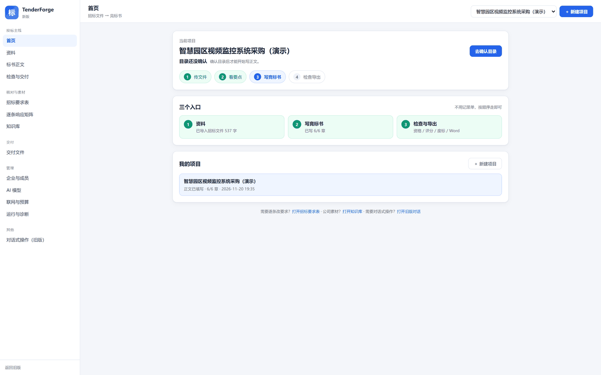
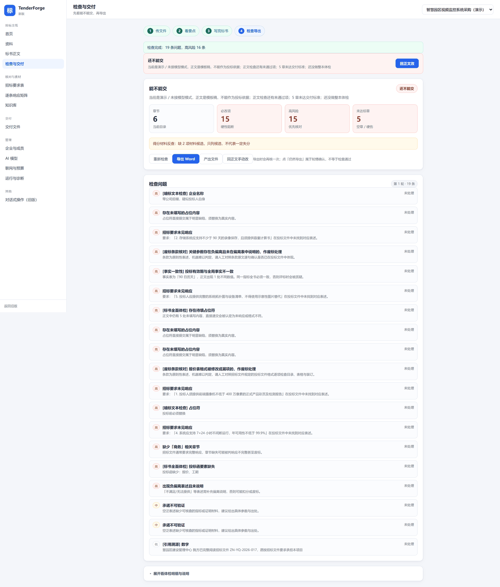
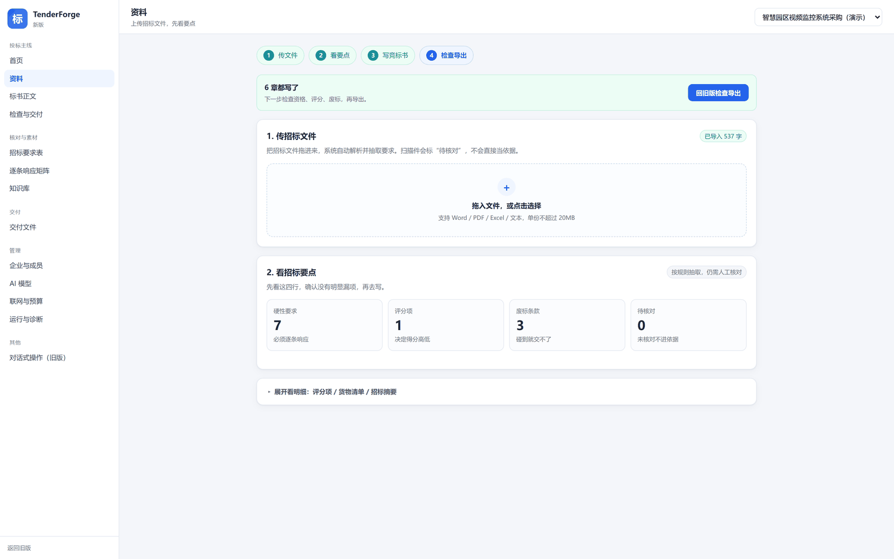
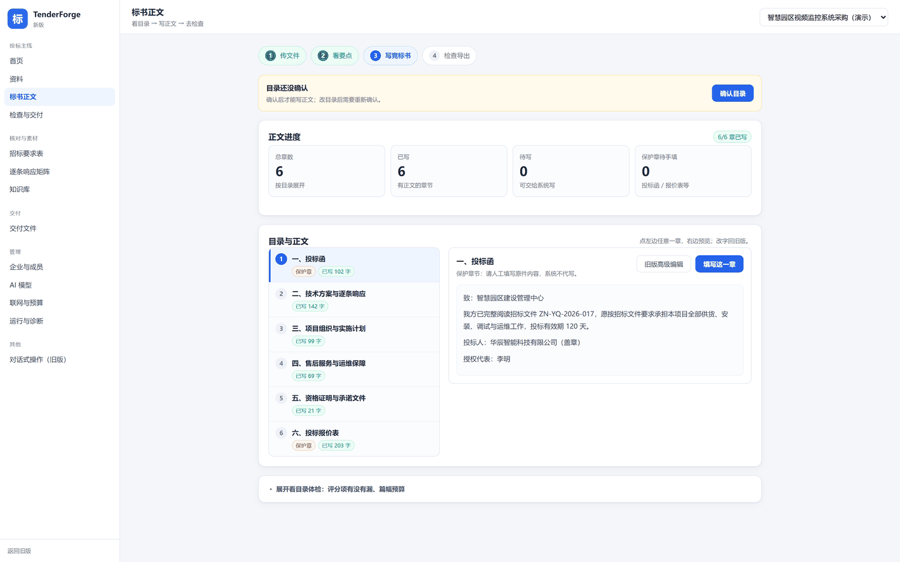
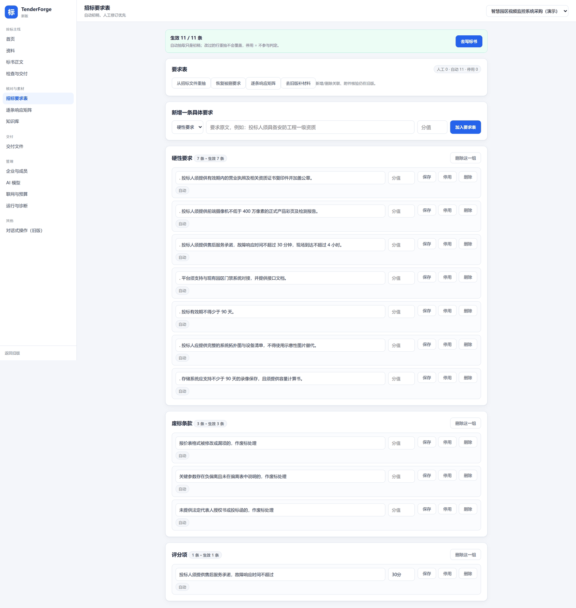
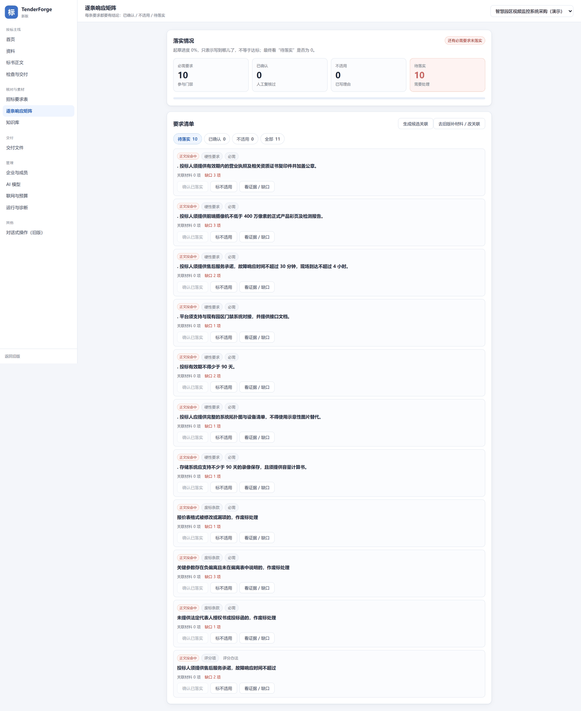
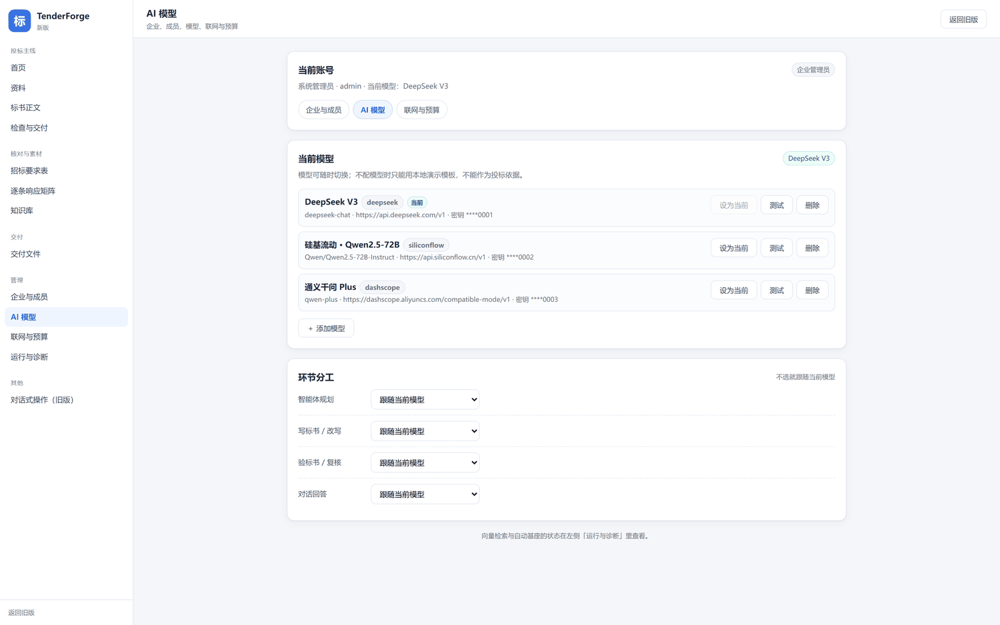
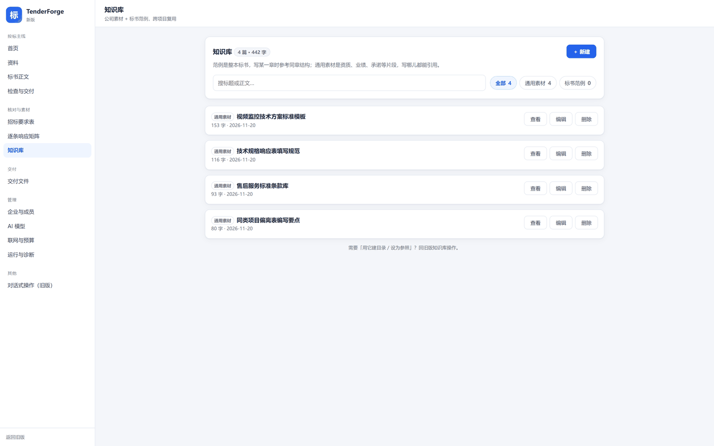

# TenderForge · 标书锻造

<p align="center">
  
  
  
  
</p>

**把一份招标文件变成一本能交的投标文件。** 本地部署、数据不出机器、全流程留痕。

招标文件上传 → 自动解读评分点 → 定目录 → 逐章写正文 → 「能不能交」体检 → 导出 Word。

<p align="center">
  
</p>

<p align="center"><sub>首页：当前项目进度、三个入口、项目列表 —— 从传文件到导出，一眼看到走到哪一步</sub></p>

---

## 这是什么

TenderForge（标书锻造）只站在投标人这一侧：不评标、不猜中标，只解决一件事——把你手上那份几百页的招标文件，变成一本能改、能交的投标文件。

- **输入**：招标文件（Word / PDF / Excel）、企业资质、历史业绩
- **输出**：成稿 Word（目录、页码、表格样式齐全）+ 一份体检报告（哪些项高风险、哪些没依据）
- **中间的活**：扒评分表、对资格条件、反推目录、逐章写正文、查暗标露名、核报价大小写——它跑一遍，人只负责判断和签字

**谁适合用**

- **投标专员** —— 不用再从 300 页里手工摘评分点，漏项清单直接生成
- **技术负责人** —— 技术方案先跑出骨架和素材，再改比重写快得多
- **小团队 / 个人投标** —— 没有专职标书岗，也能跑出结构完整的稿子
- **代理机构** —— 多企业多项目并行，按企业物理分库互不干扰

## 它解决什么问题

写标书最贵的不是写字，是**漏**。

- 招标文件 300 页，评分表藏在附件里，漏一条就少几分，漏一条★就废标；
- 写完了不知道「这条响应有没有依据」，全靠人回忆；
- 暗标要求不能出现公司名，Word 属性、页眉、图表里却到处都是；
- 报价大小写不一致、工期和招标文件对不上，这种错最冤；
- 改到第 8 版，已经不知道哪版是最终稿。

TenderForge 把这些问题变成**可检查的项**，在导出前一次性摊开给你看。

<p align="center">
  
</p>

<p align="center"><sub>一次检查出 19 条问题，逐条给出位置与原因：占位内容没删、★条款未响应、暗标里出现公司名、报价大小写不一致……每条都标着「未处理」，改完才消</sub></p>

## 界面一览

从传招标文件到导出 Word，五个步骤各自对应一屏，不做成一个大表单。

<table>
<tr>
<td width="50%"></td>
<td width="50%"></td>
</tr>
<tr>
<td valign="top"><sub><b>① 资料</b><br>传完招标文件自动抽取：硬性要求几条、评分项几条、废标条款几条，先看全再动笔</sub></td>
<td valign="top"><sub><b>② 标书正文</b><br>左侧目录、右侧正文，逐章生成随时改写；顶部进度卡显示已写 / 待写 / 受保护手填</sub></td>
</tr>
<tr>
<td colspan="2"></td>
</tr>
<tr>
<td colspan="2" valign="top"><sub><b>③ 招标要求表</b>——自动从招标文件里抽出的逐条要求，按硬性 / 评分 / 交付物分组。抽取难免有漏，所以每一条都能人工改、停用、补录，改过的会标注来源不再是「自动」</sub></td>
</tr>
<tr>
<td colspan="2"></td>
</tr>
<tr>
<td colspan="2" valign="top"><sub><b>④ 逐条响应矩阵</b>——每条要求都要有结论：已确认 / 不适用 / 待落实。「不适用」必须写理由，「已确认」可以点开看证据。落不到章节的要求会一直挂在「待落实」里，导不过去</sub></td>
</tr>
<tr>
<td width="50%"></td>
<td width="50%"></td>
</tr>
<tr>
<td valign="top"><sub><b>⑤ 模型自配</b><br>任意 OpenAI 兼容接口，可给规划 / 写作 / 复核 / 对话分别挂不同模型；密钥后端脱敏保存</sub></td>
<td valign="top"><sub><b>知识库</b><br>企业素材与标书范例，写作时按需引用，跨项目复用</sub></td>
</tr>
</table>

> 以上截图来自系统内置的演示项目（首次启动自动创建，内容为虚构），可直接点开对照。

## 核心功能

| 环节 | 能力 |
|---|---|
| **招标解读** | 解析 Word/PDF/Excel，抽取评分项、资格要求、废标条款、工程量清单、最高限价 |
| **要求矩阵** | 每条要求对应到章节与依据，标出未响应、响应不全 |
| **目录生成** | 按招标文件评分办法反推章节结构，可增删改名 |
| **逐章写作** | 单章生成 / 整本一键写，断点续写、失败重试自动跳过已完成章 |
| **检查与体检** | 三态结论（通过 / 待确认 / 高风险），占位符、空章、前后矛盾、数字对不上 |
| **废标核对** | ★条款、否决项逐条对照，标出未覆盖项 |
| **暗标检查** | 公司名、人名、电话、Logo、文档属性、页眉页脚残留检测 |
| **雷同检查** | 同企业历史标书相似段落比对 |
| **偏离表 / 报价** | 自动生成偏离表，大小写金额一致性校验 |
| **导出交付** | Word 成稿，带目录、页码、表格样式；导出前门禁 + 一次性知情令牌 |
| **留痕** | 每次检查、每次导出、每次模型调用都有记录，可回溯 |

## 几个刻意的设计选择

**本地优先，数据不出机器。** 默认 `demo` 模式，不联网、不调模型，全部用本地规则跑通流程。接自己的模型要显式打开，且有出境开关与日预算。

**模型自己配，不绑厂商。** 任何 OpenAI 兼容接口都能接，Chat Completions 与 Responses（Codex 系列）双协议。可给「规划 / 写作 / 复核 / 对话」四个环节分别挂不同模型——便宜的跑规划，强的跑写作。

**按企业物理分库。** 多个企业共用一个部署时，模型密钥、知识库、项目数据各自独立，不是靠一个字段过滤。

**语义检索可关。** 关着是纯词法检索，零费用；开了支持「换个说法也能搜到」，接 5 家 embedding 平台或自建服务。

**不假装能交付。** 没配模型时生成的是模板稿，系统会明说「这是模板稿，不能投标」并标红，不会骗你。

## 快速开始

```bash
# 1. 获取代码
git clone https://github.com/13653221196/tenderforge.git
cd tenderforge

# 2. 装依赖（Python 3.10+）
pip install -r backend/requirements.txt

# 3. 启动
python -m uvicorn backend.app.main:app --host 127.0.0.1 --port 5210
```

Windows 用户直接双击 **`启动.bat`**，会先自检再拉起服务。

打开 <http://127.0.0.1:5210>，首次启动会自动创建管理员，**账号 `admin`，密码在 `data/初始管理员.txt`**（随机生成，登录后请立刻修改）。

详细的 Windows / Linux / Docker 部署见 **[docs/安装部署.md](docs/安装部署.md)**。

## 接上自己的模型

登录后进「设置」→「模型配置」：

1. 从服务商预设里选一家（内置 DeepSeek、通义百炼、硅基流动、火山方舟、百度千帆、智谱、Kimi、MiniMax、阶跃、混元、OpenAI、Codex、Gemini 等），地址和模型名会自动填好；
2. 填自己的 API Key；
3. 点「测试连通」，通过后「设为当前」。

然后把「设置」→「运行模式」从 `demo` 切到 `live`，并确认数据出域开关。

也可以不碰界面，直接用环境变量：

```bash
LLM_BASE_URL=https://api.deepseek.com/v1
LLM_API_KEY=sk-你的密钥
LLM_MODEL=deepseek-chat
```

> 没有 API Key 也能完整体验全流程——demo 模式用本地规则生成模板稿，功能链路和真实模式一致。

## 文档

- **[docs/安装部署.md](docs/安装部署.md)** — 安装、启动、反向代理、环境变量、备份恢复
- **[docs/使用手册.md](docs/使用手册.md)** — 从上传招标文件到导出 Word 的完整操作说明
- 系统内「帮助」按钮打开的 `web/manual.html` 是同款在线手册

## 技术栈

Python 3.10+ / FastAPI / SQLite（WAL）/ Vue 3 前端（已预构建，开箱即用）/ python-docx / PyMuPDF / LangChain（可选）。

单进程、单端口、零外部依赖即可运行，不需要 Redis、不需要 Node —— 前端构建产物已随仓库提供，改样式才需要 Node。

界面有两套：`/vue/home.html` 是重构版（上方截图），`/` 是早期原生 JS 版，功能一致，后者保留作为对照。

## 免责声明

**本工具不保证中标，也不替代人的判断。**

它做三件事：不漏项、给证据、留痕迹。自动生成的内容、抽取的要求、检查的结论都需要业务人员独立复核。投标是有法律后果的商业行为，递交前请逐项人工确认。

导出门禁是**提醒不是禁止**——系统会记录你确认过风险，但责任仍在投标人。

## 联系与支持

### 打赏支持

如果这个项目帮你少熬一个通宵、或者拦住了一次废标，可以扫码请我喝杯咖啡。金额随意，一块两块都是心意。

<p align="center">
  
  <br>
  <sub>微信扫码 · 金额随意</sub>
</p>

这个项目没有付费版、不锁功能、不卖课。除了打赏，这几件事其实更有用：

| 方式 | 说明 |
|---|---|
| **Star** | 最有效的支持——能让更多同行搜到这个项目 |
| **提 Issue** | 说清哪一步卡住，比打赏更有价值，下一个用的人就少踩一次坑 |
| **转给同事** | 少一个人熬夜对评分表 |

### 联系我

有问题、想定制、想聊标书自动化的落地，加微信：

<p align="center">
  
  <br>
  <sub>备注「标书」</sub>
</p>

## License

[MIT](LICENSE)
